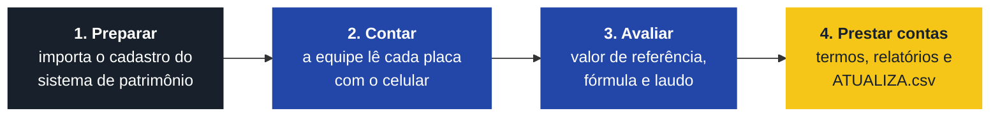
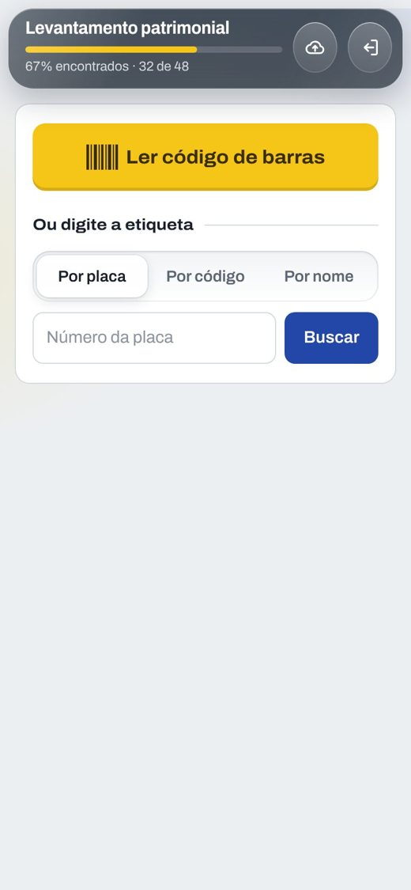
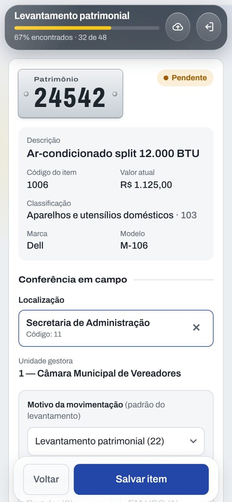
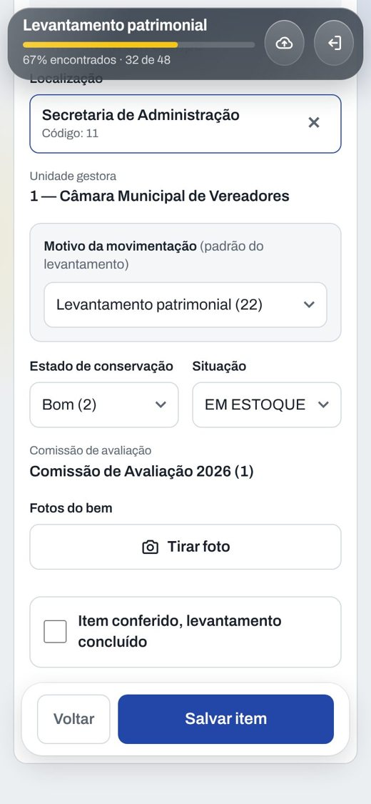
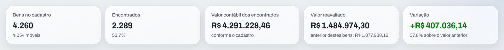

<p align="center">
  
</p>

<p align="center">
  <a href="https://agaklik.github.io/levantamento_patrimonial/"><b>Abrir o app de campo</b></a> ·
  <a href="https://agaklik.github.io/levantamento_patrimonial/admin.html"><b>Abrir o painel</b></a> ·
  <a href="docs/MANUAL.md"><b>Manual completo</b></a>
</p>

---

> **Se o Tribunal de Contas pedisse hoje a lista de todos os bens do órgão, com localização, estado e valor justo, quanto tempo levaria para entregar?**

Na maioria das prefeituras e câmaras, a resposta honesta é *"não sei"*. O cadastro diz uma coisa, as salas dizem outra, o valor contábil não reflete o que o bem vale e quem assina as contas responde por essa diferença.

**Levantamento Patrimonial** existe para fechar essa conta. Ele leva a equipe de campo de sala em sala com o celular, transforma cada placa lida em um registro com foto, autor e data, e entrega ao gestor a reavaliação, os laudos e o arquivo que atualiza o sistema de patrimônio.

Do corredor ao balanço, num só lugar.

---

## Três atos, um resultado



| | O que acontece | Onde |
| --- | --- | --- |
| **Preparar** | O cadastro sai do sistema de patrimônio em CSV e entra no painel sem apagar nada que já foi feito | Painel |
| **Contar** | A câmera lê a placa, a ficha aparece, a equipe confere sala, estado e situação, tira fotos e segue para o próximo | App de campo |
| **Avaliar** | O painel pesquisa preços pagos em compras públicas, aplica a fórmula do órgão e gera um laudo por bem | Painel |
| **Prestar contas** | Termos de responsabilidade, relatório de não localizados, relatório geral e o arquivo de volta para o sistema | Painel |

---

## No campo: rápido como ler um código de barras

<p align="center">
  
  &nbsp;
  
  &nbsp;
  
</p>

- **Aponte e pronto.** A câmera lê a etiqueta; se ela estiver ilegível, busque pela placa, pelo código ou pelo nome.
- **Sem internet, sem problema.** No modo offline o trabalho fica no celular e sobe quando houver sinal, ou vira um arquivo que o gestor importa.
- **A vida real tem bens sem placa e placas sem bem.** Os dois casos têm fluxo próprio: a placa encontrada vai para o cadastro, e o bem que não existe no cadastro vira uma *sobra*, com fotos e destinação.
- **Sala concluída é sala fechada.** Ao terminar um setor, a equipe conclui a localização. O que sobrou na localização de origem é, por definição, *não localizado*.
- **Instala como aplicativo** no Android e no iPhone, com avisos do gestor direto na tela do celular.

---

## No painel: do inventário ao valor justo

<p align="center">
  
</p>

O gestor acompanha, em tempo real, quanto já foi encontrado e quanto o patrimônio realmente vale.

### Uma reavaliação que se defende

Cada valor reavaliado nasce de três peças que qualquer auditor consegue refazer:

1. **Preço de um bem novo**, pesquisado em fontes públicas oficiais (Compras.gov.br, PNCP e LicitaCon do TCE-RS), na mesma busca. O laudo guarda até 10 preços, os mais próximos da mediana, com pelo menos um de cada fonte.
2. **Fórmula do órgão**, com tabelas de pontos para estado de conservação, vida útil já usada e vida útil restante:

   ```
   valor reavaliado = valor de bem novo × (4 × EC + 6 × PVU − 3 × VUR) ÷ 100
   ```

   O resultado nunca fica abaixo de 10% do valor de bem novo. Pesos, tabelas e piso são editáveis por cliente.
3. **Um valor por tipo de bem.** Cadeiras iguais nunca recebem referências diferentes. Mudou a referência, todos os bens daquele tipo são recalculados.

Imóveis, veículos e máquinas podem receber **laudo de engenheiro** com ART, que passa a ser o valor do bem.

### Documentos que saem prontos

| Documento | Para quê |
| --- | --- |
| **Laudo de avaliação por item** | Identificação, vistoria com fotos, metodologia, resultado e assinaturas |
| **Termo de responsabilidade** | Um por sala, com os bens encontrados, para o responsável assinar |
| **Relatório de não localizados** | O que não apareceu, por localização de origem |
| **Relatório geral da reavaliação** | Todos os bens reavaliados, com totais por classificação |
| **Histórico de alterações** | Quem fez o quê, quando, com o valor de antes e o de depois |
| **ATUALIZA.csv** | O arquivo que leva o resultado de volta ao sistema de patrimônio |

Todos têm o brasão do órgão e saem em PDF pela impressão do navegador.

---

## Construído para dados públicos

- **Cada órgão só enxerga o que é seu.** Vários clientes dividem o mesmo banco, separados por regras do próprio banco de dados, não por telas.
- **Tudo tem autor.** Quem levantou, quem reavaliou e quem concluiu cada sala fica gravado pelo servidor, com histórico que ninguém altera.
- **Acesso blindado.** Senha forte, bloqueio após três tentativas erradas, troca obrigatória da senha provisória, cadastro público desligado e sessão do painel que expira após 30 minutos sem uso.
- **Fotos privadas.** Nada fica em link público; as imagens abrem por links temporários.
- **Nenhum segredo no código.** A única chave nas páginas é a pública do Supabase; as chaves de serviço e de e-mail ficam guardadas no servidor.
- **Demonstração sem risco.** Uma prefeitura fictícia completa, com botão para voltar ao ponto de partida, e acesso de teste com prazo que só alcança essa base.
- **Cópia de segurança** de um cliente ou de todos, com fotos, em um clique.

---

## Leve por dentro

| Peça | Como é feita |
| --- | --- |
| **Sem build, sem instalação** | Duas páginas HTML com JavaScript puro, servidas como site estático (GitHub Pages) |
| **Banco, login e arquivos** | [Supabase](https://supabase.com): PostgreSQL com regras de acesso por linha, autenticação e armazenamento |
| **Funções no servidor** | Edge Functions para usuários, pesquisa de preços e avisos |
| **Funciona como app** | PWA com service worker, instalação na tela inicial e notificações |

```
index.html     App de campo
admin.html     Painel do gestor
instalar.html  QR code e passo a passo para instalar no celular
sw.js          Service worker (funcionamento offline)
supabase/      Scripts SQL e Edge Functions
docs/          Manual completo e imagens
```

---

## Quer instalar ou entender cada detalhe?

O **[manual completo](docs/MANUAL.md)** traz o passo a passo de instalação no Supabase, os layouts dos arquivos CSV e do `ATUALIZA.csv`, as regras de negócio, o banco de dados e a segurança, seção por seção.

<p align="center"><sub>As telas deste documento usam dados fictícios.</sub></p>
